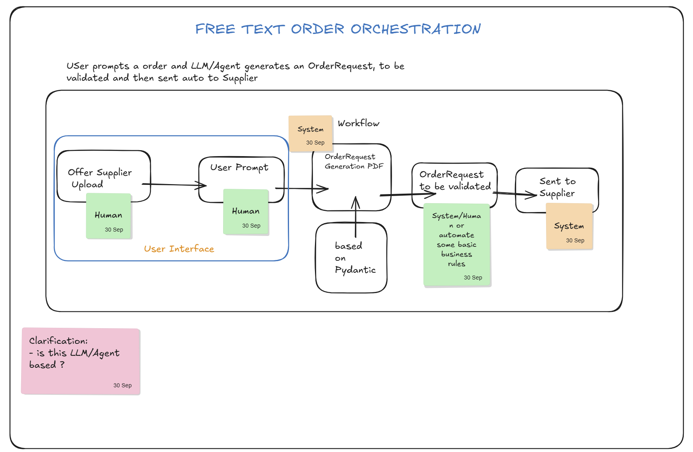

# Mappe di progetto

Bozze iniziali del team (26–30 settembre), disegnate su
[Excalidraw](https://excalidraw.com/#room=3c4bdb1147ddb60d24ab,gAuR7NMiUHYVB3bp2xksUQ). Sono input per SPECIFY e DESIGN,
non decisioni approvate: le scelte definitive vanno registrate come ADR.

## Free Text Order Orchestration

L'utente scrive un ordine in testo libero; un LLM/agente genera un
`OrderRequest` che viene validato e poi inviato automaticamente al fornitore.

| Passo | Attore |
|---|---|
| Upload dell'offerta del fornitore (UI) | Umano |
| Prompt dell'utente (UI) | Umano |
| Generazione `OrderRequest` + PDF, basata su Pydantic | Sistema |
| Validazione dell'`OrderRequest` | Sistema/Umano, o regole di business automatiche |
| Invio al fornitore | Sistema |

Domanda aperta: il flusso è basato su LLM/agente?

## Catalog Order Logic

Il prompt in linguaggio naturale viene scomposto usando dati anagrafici e
regole di business. Esempio: "I need 5 new Lenovo Laptop" →
`quantity: 5`, `productName: "Lenovo Laptop"`, `productCategory: "Laptop"`.

- **Regola di business:** tutti gli ordini passano dall'ERP (tramite prompt).
- **Tre tipi di catalogo:** Catalog, Free text, OCI Punchout.
- **Entità:** Supplier, User, ProductCategory, CostCenter, ApprovalWorkflow,
  ProcurementRequest, ParsedRequest, CatalogItem, ContractType.
- **Value object:** price, currency, amount, sku, quantity.
- **Stati del workflow:** CREATED → PARSED → RESOLVED → VALIDATED →
  PENDING_APPROVAL → APPROVED → ORDER_SENT → GOODS_RECEIPT → COMPLETED
  (poi JSON → API SAP → Goods Receipt).
- **Livelli:**
  - Domain: ProcurementRequest, SourcingRules, ParsedRequest
  - Application: ParseRequestUseCase, ResolveItemUseCase, CreateOrderUseCase
  - Infrastructure: endpoint FastAPI, repository SQLite, adapter LLM
- **JSON di esempio:** `parsedData`, `resolvedData` (sku, supplierId,
  unitPrice, currency CHF), `validation` (budgetCheck, stockCheck,
  requiresApproval, approvalLevel MANAGER), `workflow` (currentState,
  nextState, history).

Domanda aperta: se più cataloghi offrono lo stesso prodotto, quale si sceglie?
La bozza propone `min(matching_items, key=lambda x: x.unit_price)`, oppure una
strategia di procurement aziendale.
